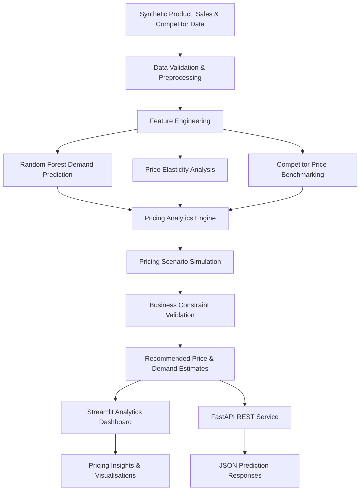

# Dynamic Pricing and Competitor Intelligence Platform

An AI-powered pricing analytics system designed to analyse product demand, estimate price-response relationships, benchmark competitor pricing, and generate data-driven pricing recommendations under configurable business constraints. The platform integrates demand prediction using Random Forest regression, price elasticity analysis, competitor price comparison, and pricing optimisation to support strategic retail pricing decisions. It provides an interactive Streamlit dashboard and FastAPI REST service for exploring pricing scenarios and analytical insights.

> **Data Notice:** The included product, sales, and competitor-price datasets are synthetically generated for demonstration. Competitor prices are simulated and are not collected from live retailers. Model predictions and pricing recommendations are experimental estimates, not guaranteed business outcomes or evidence of actual revenue or profit improvements.

## Key Features

- **Synthetic Retail Data Generation:** Creates reproducible product, sales, promotion, and competitor pricing datasets.
- **Data Preprocessing:** Validates product records, pricing information, sales quantities, and categorical attributes.
- **Demand Forecasting:** Uses Random Forest regression to estimate product demand from historical-like observations.
- **Price Elasticity Analysis:** Examines relationships between product prices and estimated demand.
- **Competitor Price Intelligence:** Compares internal product prices with simulated competitor prices.
- **Constrained Pricing Recommendations:** Generates suggested prices within configurable minimum and maximum price boundaries.
- **Pricing Scenario Simulation:** Evaluates potential demand, revenue, and profitability under alternative pricing scenarios, where cost information is available.
- **Interactive Dashboard:** Visualises demand predictions, price comparisons, elasticity estimates, and pricing recommendations through Streamlit.
- **REST API Integration:** Exposes pricing prediction and recommendation functionality through FastAPI.
- **Reproducible Experiments:** Includes model evaluation, unit tests, exploratory notebooks, and technical documentation.

## System Architecture



## Core Analytical Modules

### 1. Retail Data Generation and Preprocessing

Creates and prepares structured retail datasets for pricing analytics.

**Input attributes:**

| Feature | Description |
|---|---|
| `product_id` | Unique product identifier |
| `category` | Product category |
| `our_price` | Current selling price |
| `competitor_price` | Simulated competitor selling price |
| `promotion` | Promotion or discount indicator |
| `day_of_week` | Day associated with the observation |
| `units_sold` | Observed or synthetically generated sales quantity |

Preprocessing operations include:

- Data validation and consistency checks
- Missing-value handling
- Duplicate record checks
- Categorical variable encoding
- Numerical feature preparation
- Feature selection and transformation

### 2. Machine Learning-Based Demand Forecasting

Implements a supervised regression pipeline to estimate product demand using retail pricing and contextual variables.

**Baseline algorithm:** Random Forest Regressor

The model analyses features such as:

- Product selling price
- Competitor price
- Product category
- Promotion indicator
- Day of the week

The predicted demand estimates can be used to compare potential pricing scenarios.

**Model outputs:**
- Predicted units sold
- Demand comparisons across pricing scenarios
- Product-level demand estimates
- Regression evaluation metrics

The model learns patterns from synthetic historical-like observations. Its predictions should not be interpreted as validated real-world demand forecasts.

### 3. Price Elasticity Analysis

Examines the relationship between changes in selling prices and corresponding changes in demand.

Price elasticity of demand measures the percentage change in quantity demanded relative to the percentage change in price.

\[
E_p =
\frac{\%\text{ Change in Quantity Demanded}}
{\%\text{ Change in Price}}
\]

**General interpretation:**

| Elasticity | Interpretation |
|---|---|
| \(|E_p| > 1\) | Relatively elastic demand |
| \(|E_p| < 1\) | Relatively inelastic demand |
| \(|E_p| = 1\) | Unit-elastic demand |

For conventional demand relationships, price elasticity is generally negative.

The analysis helps explore how product demand may respond to different pricing levels. Estimates based on observational or synthetic data do not establish causal price effects.

### 4. Competitor Price Intelligence

Analyses internal product prices against available competitor price observations.

**Analytical capabilities:**

- Product-level competitor price comparison
- Price difference calculation
- Relative price positioning
- Category-wise price benchmarking
- Identification of products priced above or below simulated competitors
- Competitor price comparison visualisations

Price positioning is intended to provide market-comparison insights rather than automatically determine the optimal selling price.

### 5. Constrained Pricing Optimisation

Generates suggested product prices using demand estimates, price-response analysis, and configurable business constraints.

**Pricing workflow:**

1. Select the product and current pricing information.
2. Generate alternative candidate prices.
3. Estimate demand for each candidate price.
4. Evaluate relevant pricing scenarios.
5. Apply configured minimum and maximum price boundaries.
6. Rank eligible scenarios using the selected business objective.
7. Present the recommended price with supporting analytical information.

**Configurable constraints:**
- Minimum selling price
- Maximum selling price
- Permitted price-change range
- Competitor price reference
- Product-level pricing boundaries

**Important:** Revenue and profit optimisation are different objectives. Profit optimisation requires reliable unit-cost data. Without cost information, recommendations should be described as demand- or revenue-oriented rather than profit-maximising.

### 6. Pricing Scenario Simulation

Allows alternative prices to be explored before making pricing decisions.

Relevant indicators include:

| Indicator | Description |
|---|---|
| Current Price | Existing product selling price |
| Recommended Price | Model-generated suggested price |
| Competitor Price | Simulated competitor reference |
| Predicted Demand | Estimated units sold |
| Price Difference | Difference between current and suggested prices |
| Estimated Revenue | Selling price multiplied by estimated demand |

Where unit-cost data is available, additional profitability indicators can be calculated:

\[
Revenue = Price \times Predicted\ Demand
\]

\[
Gross\ Profit =
(Price - Unit\ Cost) \times Predicted\ Demand
\]

These are scenario estimates, not guaranteed financial outcomes.

### 7. Interactive Pricing Analytics Dashboard

The Streamlit dashboard combines pricing analytics and model predictions into an interactive interface.

- Retail pricing overview and KPI summaries
- Product-level demand predictions
- Price elasticity visualisations
- Competitor price comparisons
- Pricing scenario simulation
- Configurable pricing constraints
- Recommended price exploration
- Revenue and profitability analysis, where cost data is available
- Interactive filters and analytical charts

## Technology Stack

| Category | Technologies |
|---|---|
| Programming Language | Python |
| Data Processing | Pandas, NumPy |
| Machine Learning | Scikit-learn |
| Regression Algorithm | Random Forest Regressor |
| Pricing Analytics | Price Elasticity Analysis |
| Data Visualisation | Matplotlib, Plotly |
| Dashboard | Streamlit |
| Backend API | FastAPI, Uvicorn |
| Data Format | CSV, JSON |
| Model Persistence | Joblib |
| Testing | Pytest |
| Development Environment | Jupyter Notebook, VS Code |
| Version Control | Git, GitHub |

## Quick Start

### Prerequisites

- Python 3.10 or later
- pip package manager
- Git (optional)

### 1. Clone the Repository

```bash id="2m8q4v"
git clone <repository-url>
cd <repository-folder>
```

### 2. Create a Virtual Environment

```bash id="7x3p9k"
python -m venv venv
```

**Windows:**
```bash id="5n2w8q"
venv\Scripts\activate
```

**macOS / Linux:**
```bash id="9v4m1x"
source venv/bin/activate
```

### 3. Install Dependencies

```bash id="4q7k2p"
pip install -r requirements.txt
```

### 4. Generate Synthetic Retail Data

```bash id="6p3x8m"
python scripts/generate_data.py
```

### 5. Train the Demand Prediction Model

```bash id="1k9v5q"
python scripts/train_model.py
```

### 6. Launch the Streamlit Dashboard

```bash id="8m2w6n"
streamlit run app/streamlit_app.py
```

Open the local URL displayed in the terminal to access the pricing analytics dashboard.

> **Note:** The commands above assume the example script and application paths exist in the repository. Adjust them to match the actual implementation.

## FastAPI Integration

The project includes a lightweight REST API for accessing demand prediction and pricing analytics functionality.

### Start the API Server

```bash id="3q6n9v"
uvicorn api.main:app --reload
```

### Access Interactive API Documentation

Open Swagger UI:

```text id="5x1m8p"
http://127.0.0.1:8000/docs
```

### API Capabilities

- API health checks
- Product demand prediction
- Competitor price comparison
- Pricing scenario analysis
- Constrained price recommendations
- JSON-based prediction responses

Actual endpoint names, supported operations, and request/response schemas should match the implemented FastAPI service.

## Model Evaluation

The Random Forest regression model can be evaluated using standard regression metrics.

| Metric | Purpose |
|---|---|
| MAE | Measures average absolute prediction error |
| RMSE | Penalises larger prediction errors more strongly |
| R² Score | Measures the proportion of target variance explained by the model |

**Evaluation considerations:**

- Use appropriate training and testing splits.
- Apply chronological splitting when observations have a meaningful time dimension.
- Avoid data leakage during feature engineering.
- Compare model performance against a simple baseline.
- Evaluate predictions across product categories where sufficient observations exist.
- Report actual experimental results rather than assumed performance.

Synthetic-data evaluation demonstrates implementation behaviour, not proven retail forecasting accuracy.

## Project Structure

```text id="7v2p4m"
Dynamic_Pricing_Intelligence/
│
├── api/
│   └── main.py                  # FastAPI application
│
├── app/
│   └── streamlit_app.py         # Interactive dashboard
│
├── data/
│   └── synthetic_retail_data.csv
│
├── docs/
│   ├── methodology.md           # Technical methodology
│   └── data_dictionary.md       # Dataset documentation
│
├── notebooks/
│   └── exploratory_analysis.ipynb
│
├── scripts/
│   ├── generate_data.py         # Synthetic data generation
│   └── train_model.py           # Model training pipeline
│
├── src/
│   ├── preprocessing.py          # Data preparation
│   ├── feature_engineering.py    # Feature creation
│   ├── demand_model.py           # Demand prediction
│   ├── elasticity.py             # Price elasticity analysis
│   ├── competitor_analysis.py    # Competitor benchmarking
│   └── pricing_engine.py         # Pricing recommendations
│
├── tests/                        # Unit tests
│
├── requirements.txt
└── README.md
```

*This is a suggested repository layout. Retain the actual filenames and modules implemented in your project.*

## Limitations

- The bundled product, sales, and competitor-price datasets are synthetic.
- Competitor prices are simulated rather than retrieved from live retail platforms.
- Price elasticity estimates rely on simplified observational relationships.
- Random Forest predictions may not capture complex temporal demand patterns.
- Promotions, inventory availability, competitor responses, and seasonality may not be fully represented.
- Revenue and profit estimates depend on the accuracy of demand predictions and the availability of reliable cost information.
- Pricing recommendations do not establish causal price effects or guarantee improved financial performance.
- Production pricing requires independent validation, operational constraints, legal review, and human oversight.

## Responsible Use

- Use this project strictly for educational, research, and portfolio demonstration purposes.
- Ensure datasets are legally obtained and comply with applicable data protection requirements.
- Protect confidential business information and customer data.
- Treat AI-generated predictions as decision-support insights rather than guaranteed outcomes.
- Validate demand models and pricing assumptions before considering real-world applications.
- Avoid discriminatory, deceptive, collusive, or unfair pricing practices.
- Maintain human oversight over pricing decisions.
- Review applicable competition and consumer-protection requirements before implementing automated pricing strategies.

## Future Enhancements

- XGBoost and LightGBM demand forecasting
- Time-series demand forecasting
- Advanced nonlinear price elasticity modelling
- Causal inference for estimating price effects
- Live competitor price integration through authorised data sources
- Inventory-aware pricing optimisation
- Promotion and discount effectiveness analysis
- Multi-product and category-level pricing optimisation
- Mathematical optimisation using business constraints
- Pricing performance monitoring and model drift detection
- Docker-based deployment and cloud integration

## Author

**Mohamed Riyaz S.**  
Integrated M.Tech – Computer Science and Engineering (Business Analytics)  
Vellore Institute of Technology (VIT), Chennai
